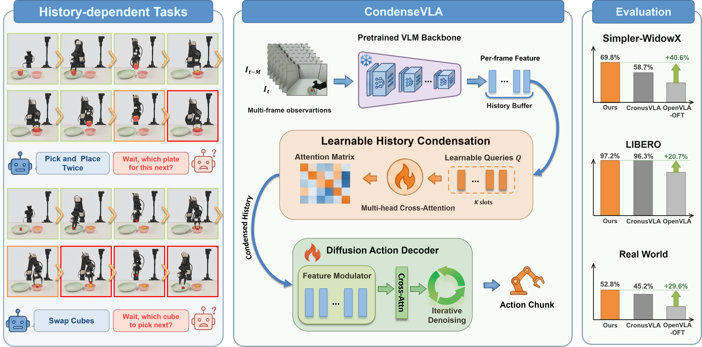
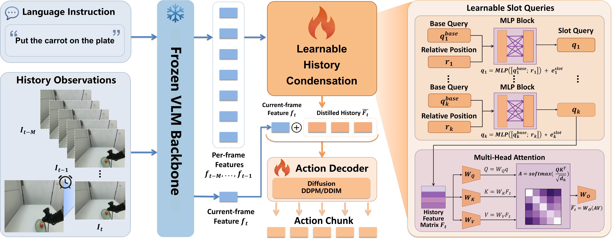

# CondenseVLA

### Learnable History Condensation for Efficient Multi-Frame VLA

**NeurIPS 2026**

[Feiyang Hong](https://openreview.net/profile?id=~Feiyang_Hong1)<sup>1</sup>, [Yujie Wei](https://openreview.net/profile?id=~Yujie_Wei7)<sup>2</sup>, [Bo Zhao](https://openreview.net/profile?id=~Bo_Zhao4)<sup>3</sup>, [Xiu Su](https://openreview.net/profile?id=~Xiu_Su1)<sup>4</sup>, [Hongxun Yao](https://openreview.net/profile?id=~Hongxun_Yao1)<sup>2</sup>, [Shuo Yang](https://openreview.net/profile?id=~Shuo_Yang5)<sup>1,*</sup>

<sup>1</sup> Harbin Institute of Technology, Shenzhen  
<sup>2</sup> Harbin Institute of Technology  
<sup>3</sup> Shanghai Jiao Tong University  
<sup>4</sup> Central South University  
<sup>*</sup> Corresponding author

> **Code coming soon in 3 months.** This repository currently provides the method overview and experimental results.

## Overview

Robot manipulation often requires knowing what happened a few moments ago. In **Pick and Place Twice**, the robot must remember whether it has already moved the object to the other plate; in **Swap Cubes**, it must keep track of which cube to move next.

**CondenseVLA** equips a vision-language-action policy with **Learnable History Condensation (LHC)**. LHC turns cached visual history into a fixed number of learned slots that condition a diffusion action decoder, allowing the policy to use recent observations without passing the entire history to the decoder.



## Architecture



1. **Encode and cache.** Encode the current observation with the vision-language backbone and reuse cached features from earlier observations.
2. **Condense history.** Learned slot queries attend to the cached features and produce a compact set of history summaries.
3. **Predict actions.** A diffusion decoder uses the history slots together with the current observation feature to predict the next action chunk.

Fine-tuning freezes the vision encoders and language model while updating the multimodal projector, LHC, and action decoder. Attention-diversity and slot-decorrelation losses encourage complementary summaries. The number of history-conditioning slots stays fixed as the history window grows.

## Main Results

Mean task success rate (%); higher is better. Each row uses the corresponding benchmark setting from the paper.

| Benchmark | CronusVLA | CondenseVLA |
|:--|--:|--:|
| Simpler-WidowX | 58.7 | **69.8** |
| LIBERO | 96.3 | **97.2** |
| RMBench | 14.3 | **21.6** |
| Real-world manipulation | 45.2 | **52.8** |

Simpler-WidowX and local LIBERO results average three evaluation seeds of fixed trained checkpoints. RMBench uses 100 evaluation rollouts per task across nine tasks. Real-world evaluation uses 50 trials per task and method on a Galaxea R1 Lite robot.

### Real-world Tasks

Final task success rate (%) over 50 trials per task and method.

| Task | CronusVLA | CondenseVLA |
|:--|--:|--:|
| Put Apple on Plate | 66.0 | **70.0** |
| Open then Close Drawer | 48.0 | **54.0** |
| Pick and Place Twice | 40.0 | **50.0** |
| Swap Cubes | 50.0 | **62.0** |
| Put Objects in Drawer | 22.0 | **28.0** |
| **Average** | **45.2** | **52.8** |

Pick and Place Twice transfers the apple to the other plate and then returns it. Put Objects in Drawer requires placing both objects inside and closing the drawer.

## Code Release

**Coming soon in 3 months.**

The release will include the implementation and instructions for training and evaluation. Updates will be posted in this repository.

## Citation

If you find this work useful, please cite:

```bibtex
@inproceedings{hong2026condensevla,
  title={{CondenseVLA}: Learnable History Condensation for Efficient Multi-Frame {VLA}},
  author={Hong, Feiyang and Wei, Yujie and Zhao, Bo and Su, Xiu and Yao, Hongxun and Yang, Shuo},
  booktitle={Advances in Neural Information Processing Systems},
  year={2026}
}
```

## Contact

For questions, please contact [Feiyang Hong](mailto:feiyanghong7040@qq.com) or [Shuo Yang](mailto:shuoyang@hit.edu.cn).
